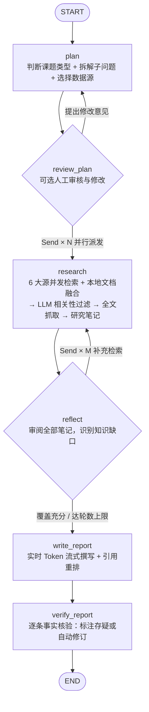

<div align="center">

# ✦ Deep Research Agent & Intelligent Studio

**基于 LangGraph 的全链路学术与行业深度调研智能体 · 交互式研究工作台**

[](LICENSE)
[](pyproject.toml)
[](https://github.com/langchain-ai/langgraph)
[](deep_research/web/server.py)
[](tests/)

*输入任意学术前沿方向、技术演进或行业课题，自动完成：**子问题拆解 → 6 大数据源并行检索 → 本地私有文档融合 → LLM 相关性打分过滤 → 论文全文抓取精读 → 多轮反思补全 → 实时流式撰写 → 逐条事实核验**，并生成高度可交互的现代化研究报告。*

[核心亮点](#-核心亮点) • [架构流程](#-langgraph-智能体架构) • [智能交互工作台](#-intelligent-research-studio-特性) • [快速开始](#-快速开始) • [Docker 部署](#-docker-一键部署) • [贡献指南](CONTRIBUTING.md)

</div>

---

## 🌟 核心亮点

### 1. 🔍 6 大公开数据源 + 本地私有资料混合深潜（Hybrid Deep Research）
- **arXiv**：官方 API 检索最新预印本论文（内置智能限速与重试）。
- **Semantic Scholar + OpenAlex 自动熔断回退**：获取论文引用量、发表会议/期刊元数据；当无 Key 触发 S2 `429` 限流时自动切换至免费的 **OpenAlex**。
- **Hugging Face Papers**：追踪近期高热度 AI 论文与开源模型报告（网络受限时自动回退 OpenAlex）。
- **Web（Tavily / DuckDuckGo）**：优先使用 [Tavily](https://tavily.com)，未配置 Key 时自动回退免费的 DuckDuckGo（`ddgs`）。
- **GitHub Repositories**：检索高 Star 开源项目、工程实现与生态对比。
- **Hacker News**：通过 Algolia API 采集技术社区真实讨论与工程落地反馈。
- **📎 本地 PDF / Markdown / TXT 上传融合**：支持在 Web 界面直接挂载本地论文 PDF、技术白皮书或实验笔记，作为高优先级带引用来源（`[本地文档]`）与公网检索结果一起参与综述撰写与核验。

### 2. 📖 论文全文抓取精读 + 逐条事实核验闭环（Fact-Check Verifier）
- **相关性打分与加权排序**：LLM 对初筛候选进行 `0-10` 相关性打分，结合发表年份与引用影响力自动剔除噪音。
- **高分论文全文提取**：自动抓取 arXiv HTML / ar5iv / PDF 全文及网页正文，提取方法、实验、消融与局限等核心段落（内置 SSRF 内网防护）。
- **防幻觉事实核验**：自动抽取报告中带 `[n]` 引用的核心陈述，逐条对照原始摘要与全文节选判定 `✅ 完全支持`、`🔶 部分支持/表述偏强` 或 `⚠️ 缺乏依据`，支持**批注提醒（`annotate`）**或**自动收窄修订（`revise`）**。

### 3. ✨ 新一代 Intelligent Research Studio（智能交互式报告与伴读工作台）
告别静态枯燥的长文 Markdown，Web 工作台将报告转化为**可探索、可对话、可局部精炼**的动态分析界面：
- **🗺️ 课题知识图谱与 Mermaid 架构图**：报告顶部自动合成课题分类导览图谱（点击节点平滑直达章节），支持正文内嵌 Mermaid 架构/时序图缩放与复制。
- **📊 结构化对比表「表格 / 名片 / 柱状图」三态切换**：所有 Markdown 表格自动升级为支持关键词过滤、表头点击排序、工作名片网格与**自动提取量化指标的可视化水平柱状图**。
- **💬 Ask This Report 伴读 Copilot（SSE 逐字流式 + 一键插入报告）**：悬浮可自由拖拽/缩放的伴读助手，基于当前报告与全部引文实时流式作答（自带 `[n]` 文献溯源胶囊），支持将精彩回答一键追加为报告新章节。
- **🪄 正文划词浮动 AI 菜单 & 章节级 AI 精炼（含多级撤回）**：在正文中用鼠标划词即可弹出 `💡 解释概念`、`🔍 追问此段`、`✨ 扩写润色` 浮动工具栏；每个章节头部支持一键 AI 扩写/表格化/提炼要点，并配备章节级与全局级 **`↩ 撤回修改`**。
- **📈 文献时间线与学术影响力气泡矩阵**：在「文献与来源库」标签页可视化展示发表年份分布柱状图（点击按年份筛选）与引用影响力 SVG 散点矩阵。
- **⚖️ 双报告并排对比 + BibTeX / 单文件交互 HTML 导出**：支持一键对比两份历史报告的重合引文与结论演进；支持导出可导入 Zotero/LaTeX 的 `.bib` 文件以及**双击即可离线交互阅读的单文件 `.html` 报告**。

---

## 🧭 LangGraph 智能体架构



| 节点 | 核心职责 | 关键机制 |
|---|---|---|
| `plan` | 识别课题导向（`academic` / `industry` / `mixed`），拆解子问题并分配检索源与检索词 | 结构化输出（不支持 `tool_choice` 的模型自动降级 `json_mode`） |
| `review_plan` | 启用审核时暂停执行，等待人工确认或输入反馈后重规划 | `interrupt()` + `Command(resume=...)` |
| `research` | 并行执行各子问题：多源检索、结果不足自动放宽、相关性过滤、抓取论文/网页全文、生成带引用笔记 | `Send` Map-Reduce 扇出、`operator.add` 归并 |
| `reflect` | 综合既有笔记检查技术盲区，按需生成补充子问题进入下一轮深潜 | 条件边循环控制 |
| `write_report` | 汇总全局来源（去重编号）与本地上传资料，实时流式生成结构化长文报告 | `astream` 实时打字机预览 |
| `verify_report` | 抽取带 `[n]` 的陈述对照原文核验，输出可信度评分、诊断卡片与自动修订 | 事实核验闭环 |

---

## 🖥️ Intelligent Research Studio 特性一览

| 模块 | 功能特性 |
|---|---|
| **📑 深度报告正文** | • **Bento 核心结论矩阵**：执行摘要自动转化为高辨识度 Bento 编号卡片<br>• **章节导读（TL;DR）与支撑源胶囊**：每节顶部自动提炼一句话导读与 `📚 本节 N 篇支撑` 胶囊<br>• **子章节分栏/线性切换 & 要点卡片化**：多 `###` 子方向自动排布为双栏卡片，支持一键切换视图<br>• **量化指标语义高亮**：自动识别 `+35%`、`2.8x`、`70B` 等关键指标并渲染为绿/橙/青色语义胶囊<br>• **ScrollSpy 动态目录**：左侧大纲随滚动实时高亮当前小节并显示 `已读 X / Y` 进度条 |
| **🪄 伴读与协同编辑** | • **正文划词 AI 菜单**：选中任意文字即刻触发 `💡 解释概念` / `🔍 追问此段` / `✨ 扩写润色`<br>• **章节 AI 精炼 + 多级撤回**：单章节局部扩写、增补 Markdown 对比表、提炼高密度要点，支持随时撤回<br>• **Copilot 流式问答**：支持窗口四周拖拽缩放、一键最大化、SSE 逐字流式回复与 `➕ 插入报告末尾` |
| **📚 文献库与核验台** | • **发表年份演进柱状图 & 影响力散点图**：点击柱条或散点气泡即可按年份筛选或弹出文献详情抽屉<br>• **行内事实核验胶囊**：点击正文中的 `⚠️ 存疑` / `🔶 偏强` 胶囊，在右侧抽屉直接对照核查诊断与原始摘要 |
| **📤 导出与持久化** | • **多格式导出**：Markdown（`.md`）、可离线交互单文件网页（`.html`）、Zotero/LaTeX 文献包（`.bib`）、印刷级 PDF<br>• **SQLite 断点续跑**：服务重启、网络波动或手动取消后，一键从上次完成的节点无缝恢复 |

---

## 🚀 快速开始

### 1. 本地安装运行（Python 3.10+）

```bash
# 克隆项目并创建虚拟环境
git clone https://github.com/ruantao1207/deepResearchAgent.git
cd deepResearchAgent
python -m venv .venv
.venv\Scripts\activate            # Linux / macOS: source .venv/bin/activate

# 安装依赖（含 DuckDuckGo 搜索、Web 服务与测试套件）
pip install -e ".[ddg,web,dev]"

# 启动 Web 智能研究工作台
deep-research-web --port 8000
```

浏览器打开 **http://127.0.0.1:8000**，点击右上角 **「⚙️ API 设置」** 填入你的 OpenAI / DeepSeek / 通义千问 / 本地 Ollama 配置，点击「保存并测试连接」即可开始调研！

---

### 2. 🐳 Docker 一键部署（适合服务器或团队共享）

```bash
cp .env.example .env
# 编辑 .env 填入 OPENAI_API_KEY（如需公网/团队共享，可设置 ADMIN_TOKEN 锁定设置面板）

docker compose up -d
```

服务将运行在 `http://localhost:8000`，生成的报告与 SQLite 断点数据自动持久化在宿主机 `./reports` 与 `./.deep_research` 目录。

---

### 3. 💻 命令行（CLI）模式

```bash
# 学术方向调研（默认开启相关性过滤、全文抓取、事实核验标注）
deep-research "Speculative decoding 加速大模型推理的最新研究与框架落地"

# 业界方向 + 人工审核计划 + 2 轮反思 + 核验后自动修订
deep-research "2026 年 AI Coding Agent 业界竞争格局与核心架构" --review --iterations 2 --verify revise

# 从 SQLite 断点继续上次中断的任务
deep-research --resume 3f9c1a2b
```

---

### 4. 🐍 Python SDK 调用

```python
import asyncio
from langgraph.checkpoint.memory import InMemorySaver
from deep_research.graph import build_graph

graph = build_graph(checkpointer=InMemorySaver())
config = {"configurable": {"thread_id": "demo", "max_iterations": 1, "verify_mode": "annotate"}}
result = asyncio.run(graph.ainvoke({"topic": "Agent Memory 记忆机制最新进展"}, config))
print(result["report"])
```

---

## ⚙️ 环境变量与配置说明

所有配置既可通过 `.env` 文件设置，也可在 Web 界面右上角 **「⚙️ API 设置」** 中在线热更新（详见 [`.env.example`](file:///.env.example)）：

| 变量名 | 必填 | 默认值 | 说明 |
|---|---|---|---|
| `OPENAI_API_KEY` | ✅ | — | OpenAI 或兼容服务（DeepSeek / 通义千问 / vLLM 等）API Key |
| `OPENAI_BASE_URL` | 否 | 官方地址 | 兼容接口地址，如 `https://api.deepseek.com/v1` |
| `LLM_MODEL` | 否 | `gpt-4o-mini` | 默认模型（规划 / 检索总结 / 相关性打分 / 反思 / 核验） |
| `WRITER_MODEL` | 否 | 同 `LLM_MODEL` | 报告撰写与章节精炼专用模型（可指定更强推理模型） |
| `TAVILY_API_KEY` | 否 | 空（回退 DDG） | Tavily 网页搜索 Key（配置后网页检索质量更高） |
| `S2_API_KEY` | 否 | 空（限流回退 OpenAlex） | Semantic Scholar API Key |
| `GITHUB_TOKEN` | 否 | 空 | GitHub API Token（提升开源仓库搜索速率限制） |
| `ADMIN_TOKEN` | 否 | 空 | **团队/公网部署推荐**：设置后修改 Web 端 API 设置需验证管理员口令 |
| `MAX_CONCURRENT_RUNS` | 否 | `2` | Web 端最大并行执行调研任务数（超出自动进入排队队列） |

---

## 🧪 运行测试

本项目包含 **56 项离线自动化测试**（涵盖 6 大数据源与回退逻辑、相关性打分、全文抓取与 SSRF 防护、事实核验与修订、SQLite 重启恢复、本地文档上传、伴读 Copilot 流式问答及设置权限保护），**无需配置任何真实 API Key** 即可全量运行：

```bash
pytest -q
```

---

## 📂 项目目录结构

```text
deep_research/
├── config.py        # 运行时配置解析（configurable > 环境变量 > 默认值）
├── state.py         # LangGraph 图状态与 Pydantic 结构化输出 Schema
├── prompts.py       # 规划 / 研究 / 相关性打分 / 反思 / 写作 / 核验 / 伴读 Copilot Prompt
├── nodes.py         # 6 个核心图节点、实时流式回调与并行路由逻辑
├── graph.py         # 组装 StateGraph 工作流
├── citations.py     # 引用编号去重映射与参考文献格式化
├── verify.py        # 事实核验：带引用陈述抽取、逐条核查、标注与自动修订
├── store.py         # Web 任务队列与 SSE 事件流 SQLite 持久化
├── reports.py       # Markdown 报告与结构化 JSON 元数据落盘
├── settings.py      # Web 运行时配置热更新与密钥脱敏管理
├── llm.py           # OpenAI 兼容 LLM 工厂（含结构化输出 json_mode 自动降级）
├── cli.py           # 命令行入口（支持 SQLite 断点续跑）
├── web/             # FastAPI 服务端 (server.py) + Intelligent Research Studio 前端 (static/index.html)
└── tools/           # 检索与抓取工具集 (arxiv / semantic_scholar / openalex / web / github / hackernews / huggingface / fulltext)
tests/               # 离线单元测试 + 端到端图测试 + Web 持久化与流式接口测试
```

---

## 📄 开源协议

本项目基于 [MIT License](LICENSE) 开源，欢迎自由使用、修改与二次开发。
